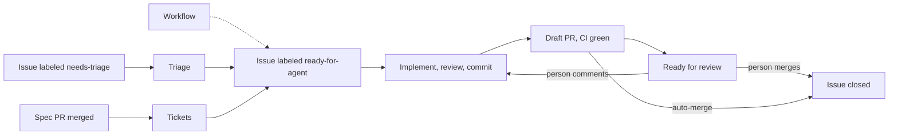
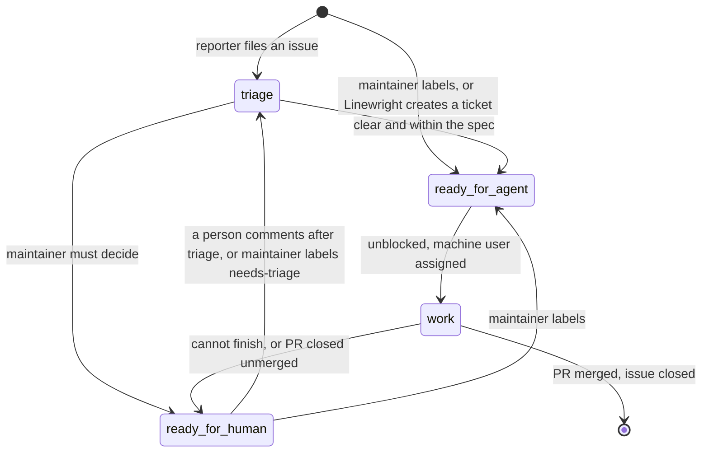
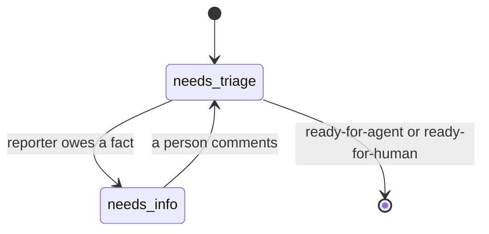
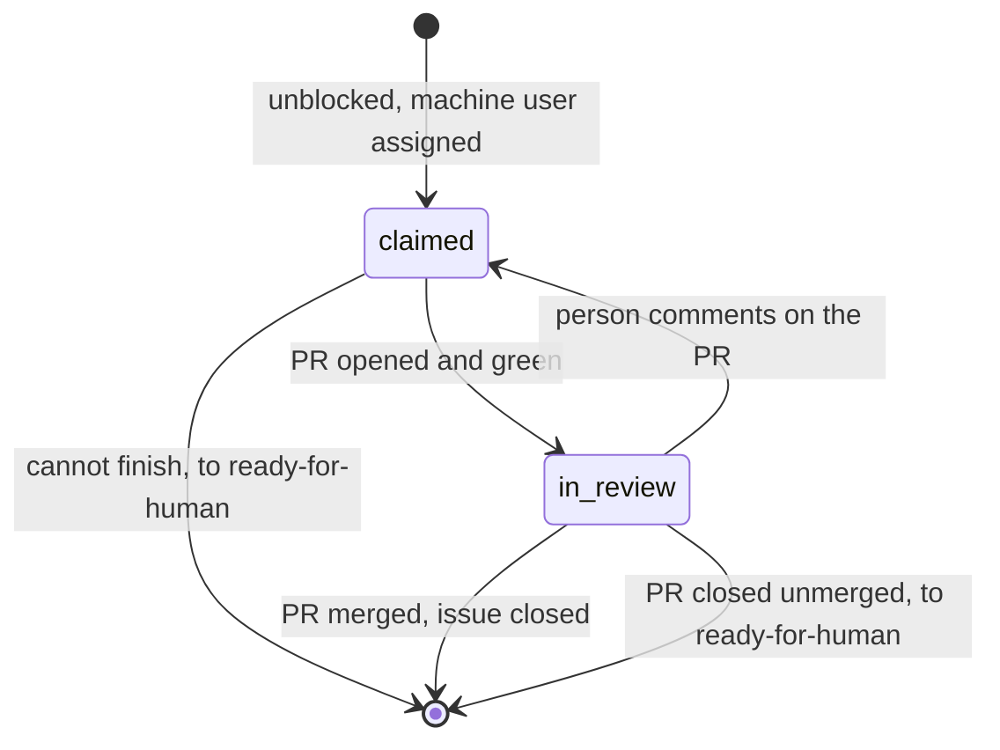

# Linewright product spec

Linewright is a spec-driven software factory: a server that watches a GitHub
repository and runs coding agents that turn spec changes and issues into
finished software, delivered as pull requests.

## Vision

A software factory: people write the specification and file the bugs, and the
factory produces the finished software. Agents plan, implement, review and
verify each other's work, with enough of them and enough automation that the
result needs little or no human review: most changes merge on their own, and
people review only the critical ones.

This spec describes the first version: from a merged spec change or an issue
to a pull request that agents have reviewed and that passes CI. It is merged,
by Linewright or by a person, or sent back with comments the factory
addresses.

## Problem Statement

I keep the specification of my software as Markdown in its repository, and
coding agents build from it. Reviewing what they build is the slow part: every
change comes back as a PR for me to read, understand and correct, and that is
where most of my time goes. The quality that would make review quick, work
that has been reviewed, tested and fixed before I see it, takes more agent
sessions than one person drives by hand. Driving them costs too: each step
between a spec change and a PR is a session I start, wait for and relay, so
work waits for me to be at a keyboard. Customer issues wait the same way:
someone has to read, classify, verify and brief before an agent can start.

## Solution

A server that polls GitHub and drives a pipeline of agent sessions from a
merged spec change or an issue to a pull request that is reviewed, green and
ready for a person.

- **Spec in, PR out.** A merged spec change or a labeled issue starts the
  pipeline and a pull request ends it. Between the two the factory runs on
  its own; when it cannot continue, it hands the item back with a label and a
  comment that says why.
- **The spec is how the maintainer steers.** Agents build from the spec and
  leave it as it is; a spec that needs changing becomes an issue for the
  maintainer.
- **Reviewed before a person sees it.** Agent review, the repository's own
  checks and CI all pass before a PR is marked ready.
- **Everything shows in GitHub.** Every state a person reads or changes is a
  label, an assignee or a pull request, so GitHub's UI shows what the factory
  is doing and lets a person change it, and a comment on the issue or PR
  records every outcome. Its labels, branches and comments are ones a person
  could have written, with no data only the factory reads, such as run ids.
- **Each stage is a fresh agent session with a brief**, and work is cut so
  that every session stays in its smart zone, the part of its context window
  where it still works at full quality.
- **Unattended.** Agents run without permission prompts, directly on a host
  or in a container, as the operator chooses.
- **Workflows beside the pipeline.** Workflows in the repository run agents
  on a trigger with instructions the maintainer writes, and may hand work to
  the pipeline.
- **Runs again on request.** A spec change the factory handled can be
  captured as a case and run through the whole pipeline on a machine, with
  every agent's trace kept, so the briefs are tuned against real cases.

User stories are told from the operator's point of view.

The pipeline, end to end:



## Repository

What Linewright needs from the repository it works on, and how people work
it: labels start and stop work, and pull requests show it.

### User Stories

1. As an operator, I want to point Linewright at a repository and have it create
   what it needs, so that setup is a token and a flag.
2. As an operator, I want the repository to stay usable by people at the same
   time, so that the factory shares the repository rather than owning it.
3. As an operator, I want Linewright to refuse to start when it cannot work, so
   that a misconfiguration is loud.
4. As an operator, I want to start work by applying one label and stop it by
   removing it, so that control needs nothing but GitHub.

### Decisions

- Requirements:
  - A GitHub repository.
  - A **machine user**: a GitHub user account for Linewright, with a token
    that lets it push branches, open pull requests, and read and write issues
    and labels. Everything Linewright does on GitHub carries that identity, so
    the maintainer can review its PRs and see its claims as assignments. With
    `--auto-merge`, the machine user must not be able to bypass the default
    branch's rules (no admin rights, not on a ruleset's bypass list), or the
    reviews they require are skipped.
  - Spec files: tracked Markdown matching the spec glob (default
    `docs/**/*.md`).
- Used when present: the files the agents' briefs rely on,
  `CODING_STANDARDS.md` (what code review holds changes to) and `GLOSSARY.md`
  (the vocabulary agents read before exploring), and CI as checks on pull
  requests. The agent instructions and configuration the runtime reads from
  the repository apply as in any session. The operator's own Claude Code
  setup does not, and sessions keep no memory of their own: what later
  sessions should know belongs in the repository.
- Labels. Linewright creates any that are missing at startup and never renames
  or deletes one. Labels only Linewright uses are prefixed `linewright:`.

  | label | meaning | set by |
  |---|---|---|
  | `needs-triage` | new, not yet assessed | reporter's issue template, maintainer |
  | `needs-info` | waiting on the reporter | Linewright |
  | `ready-for-agent` | actionable: Linewright may claim it | maintainer, Linewright |
  | `ready-for-human` | the maintainer must act or decide | Linewright |
  | `bug`, `enhancement` | category, in repositories without issue types | Linewright (triage), maintainer |
  | `linewright:spec-processed` | this merged PR's spec changes have been ticketed | Linewright |

- For issues, the human interface is two labels: `needs-triage` asks for
  triage and `ready-for-agent` asks for implementation. Spec changes need no
  label: every merged pull request that touches the spec is picked up.
  Removing `ready-for-agent`, unassigning the machine user or closing the
  issue stops its work; after an unassignment, applying `ready-for-agent`
  again restarts it.
- Machine state is derived from GitHub, never labeled. An issue is
  **claimed** when the machine user is among its assignees, and **in review**
  when an open pull request by the machine user closes it.
- Startup checks: the token can push to the repository and, with
  `--auto-merge`, the repository allows the merge method and the update
  method keeps the branch mergeable with it (`update-branch` `merge` cannot
  keep a branch rebase-mergeable); otherwise Linewright exits with an error.
- One Linewright per repository.

The lifecycle of an issue. `triage` and `work` each group several states,
drawn under [Triage](#triage) and [Pull requests](#pull-requests);
`ready-for-agent` and `ready-for-human` are the labels between them.



## Sources of work

### User Stories

1. As an operator, I want a merged change to the spec to start agents that bring
   the code in step with it, so that writing the spec is how I build.
2. As an operator, I want new issues triaged by an agent, so that reporters get
   an answer and clear issues become work without me.
3. As an operator, I want to hand any issue to the factory by labeling it, so
   that I decide what gets built.
4. As an operator, I want a spec change that is already implemented to produce
   no work, so that implementing by hand stays possible.
5. As an operator, I want agents to run on a schedule with instructions I write,
   so that recurring work happens without me.

### Decisions

- The spec is the tracked files matching the spec glob.
- A **spec change** is a pull request that was merged into the default
  branch, touched at least one spec file, was merged within the lookback
  window (default 7 days) and has no `linewright:spec-processed` label. PRs
  authored by the machine user are skipped. The spec as merged is what gets
  built; a push straight to the default branch is the maintainer's own
  change, outside the factory.
- Issues enter in two ways: with `needs-triage`, which asks for triage, and
  with `ready-for-agent`, which asks for implementation once the issue is
  unclaimed and unblocked.
- Workflows are a source of work too; see Workflows.
- Linewright polls, at an interval (default 60 s).

## Triage

### User Stories

1. As an operator, I want new issues classified and their claims verified, so
   that only real, clear work reaches an implementer.
2. As an operator, I want reporters asked for what is missing and their answers
   picked up, so that I am not the go-between.
3. As an operator, I want an issue that needs my decision handed to me with a
   recommendation and my answer in the thread picked up, so that my part is a
   decision, not research or bookkeeping.
4. As an operator, I want duplicates and already-fixed issues flagged rather
   than closed, so that no reporter is turned away by a machine.

### Decisions

- Triage runs on `needs-triage` issues not authored by the machine user
  (tickets Linewright creates are already briefed).
- The agent reads the issue and its comments, the codebase and the spec. It
  categorizes, verifies the claim (reproduces a bug, runs the tests, checks
  whether the behavior already exists) and ends in one of three states:
  - `ready-for-agent`, with a **triage brief** comment: summary, current and
    desired behavior, acceptance criteria, out of scope.
  - `needs-info`, with a comment addressed to the reporter: what is
    established, what is still needed.
  - `ready-for-human`, with a recommendation: the questions a maintainer must
    answer, or why the issue is not for an agent (duplicate, already
    implemented, needs a spec change, should be rejected).

  Facts come before decisions: while the reporter still owes a fact, the
  outcome is `needs-info`, asking only for it, even if a maintainer's
  decision will follow, because the decision usually depends on the facts.
- The category is the repository's issue type (Bug, Feature, Task) where the
  repository has issue types, and the `bug` or `enhancement` label otherwise.
- Triage leaves issues open and repository files as they are.
- An answer in the thread is picked up: when anyone other than the machine
  user comments on a `needs-info` or `ready-for-human` issue after
  Linewright's last triage comment, and that is its last comment on the
  issue, the issue is triaged again. The labels say who must answer, the
  reporter or the maintainer; either may answer by commenting, because that
  is where the question was asked. The maintainer may also hand an issue back
  with a label: `ready-for-agent` (implement as decided) or `needs-triage`
  (triage again).

The `triage` states of the issue lifecycle; both are labels.



## Tickets

### User Stories

1. As an operator, I want a spec change cut into tickets an agent session
   finishes within its smart zone, so that the work is done by agents at their
   sharpest; that each PR is small enough to review is a welcome side effect.
2. As an operator, I want tickets ordered by dependency and worked in that
   order, so that each builds on merged work.
3. As an operator, I want one place that shows a spec change's progress, so that
   I know when it is done.

### Decisions

- For each spec change an agent reads the PR's spec diff, the spec and the
  codebase and proposes tickets: vertical slices sized to a session's smart
  zone, with code that already matches the spec producing none.
- One **tracking issue** per spec change with tickets: "Spec change: <PR
  title>", linking the PR and listing the tickets, with no role label. Each
  ticket is a sub-issue of it, states what to build and its acceptance
  criteria, carries `ready-for-agent`, and is linked to the tickets it is
  blocked by with GitHub's issue dependencies.
- The PR is labeled `linewright:spec-processed` once its tickets exist, also
  when there are none, in which case no tracking issue is created.
- A decomposition that cannot finish hands the spec change back: the PR is
  labeled `ready-for-human` with a comment that says why, and removing the
  label tries again.
- A decomposition interrupted part way (the tracking issue exists, the PR is
  not labeled) is discarded, its tracking issue and tickets closed as not
  planned with a comment, and the spec change is cut again.
- A ticket is claimable when every issue blocking it is closed. Linewright
  closes the tracking issue when all its sub-issues are closed.
- The decomposition is Linewright's responsibility: it runs from a merged
  spec change to the ready PRs with no human step, and a wrong set of tickets
  from a good spec is a defect in Linewright.

## Workflows

Work the maintainer describes in the repository for an agent to do when a
trigger fires. Workflows sit beside the pipeline and may hand it work.

### User Stories

1. As an operator, I want an agent to run on a schedule with instructions I
   write, so that recurring work happens without me.
2. As an operator, I want a workflow able to hand work to the pipeline, so that
   it is built and reviewed like any other work.
3. As an operator, I want workflows defined in the repository, so that adding
   one is a reviewed change, versioned with the code.
4. As an operator, I want to run a workflow by hand, so that I can try its
   instructions without waiting for its schedule.

### Decisions

- A **workflow** is a Markdown file in `.linewright/workflows/` on the
  default branch. Its name is the file's name, its YAML front matter says
  when it runs, and its body is the agent's instructions:

  ```markdown
  ---
  on:
    schedule: "0 6 * * 1"
  timeout: 60m
  max-issues: 3
  ---
  Look at the bugs fixed in the past week ...
  ```

  | key | meaning | default |
  |---|---|---|
  | `on.schedule` | when it runs: a cron expression, in UTC | required |
  | `timeout` | the session timeout of its runs | `session-timeout` |
  | `max-issues` | the most issues one run files | 3 |

  A file that does not parse is logged and skipped; the other workflows run.
- The **trigger**, `on`, is a schedule, the only kind for now.
- A workflow is due when a tick of its schedule has passed since its last
  run. Ticks missed while Linewright was down, or while a run of the
  workflow was in flight, collapse into one run. A workflow seen for the
  first time counts as run then, so adding one does not start it at once.
  Linewright records each workflow's last run under the work directory.
- `linewright workflow run NAME` runs one workflow now and exits, and
  leaves its schedule as it was.
- A run is one agent session in a fresh clone of the default branch, counted
  against the ceiling on simultaneous runs. The agent does what its
  instructions say. Its brief carries nothing of earlier runs: a workflow
  that looks back says how far in its instructions.
- A run may hand the pipeline work: issues it returns in its result, which
  the manager files, each opening with the marker line
  `> *Linewright, workflow <name>*`:
  - `ready-for-agent`, for work an agent can do: what to build and its
    acceptance criteria, like a ticket.
  - `ready-for-human`, when a person must decide or help.

  The agent searches the existing issues first and does not file one that
  is already open. Issues beyond `max-issues` are dropped and logged.
  Workflow issues skip triage, like tickets: triage passes over issues the
  machine user authored.
- A run that fails is logged, like any failure of Linewright's own.

## Implementation

### User Stories

1. As an operator, I want each ticket implemented on its own branch from a fresh
   checkout, so that runs never interfere with each other or with my working
   copy.
2. As an operator, I want the work reviewed by agents and passing the
   repository's checks before a PR exists, so that the first version I see has
   been through review.
3. As an operator, I want the spec left as it is by agents, so that it stays
   mine.
4. As an operator, I want an agent that cannot finish to hand the ticket back
   with the reason, so that nothing stalls silently.
5. As an operator, I want several tickets worked at once up to a ceiling I set,
   so that throughput is mine to choose.

### Decisions

- Claiming is adding the machine user as an assignee. A **fresh run** (no
  open pull request for the ticket) starts from a fresh clone of the default
  branch on a new branch for the ticket, replacing any earlier one.
- The implementer reads the ticket and its comments (the triage brief, earlier
  handbacks), implements, runs the repository's checks, has the work reviewed in
  fresh contexts for both standards and spec, applies the findings and
  commits. How many review rounds it takes is its judgment, bounded by the
  session timeout.
- The implementer leaves spec files as they are, by its brief; a spec it
  cannot build from is a spec gap, below. Linewright does not check the
  branch for spec changes: they show in the PR's diff, and a maintainer who
  wants a guarantee requires review of spec files in GitHub.
- A spec gap that blocks the ticket (the spec cannot decide it) sends the
  ticket to `ready-for-human` with the question; the branch is kept. A gap
  that does not block it becomes a separate `ready-for-human` issue
  describing the needed spec change, and the ticket continues. A gap already
  filed for the ticket and still open is not filed again.
- A session's result the manager cannot parse goes back to the session with
  the parse error, so it can answer again (default once).
- Any unexpected end (crash, timeout, the agent giving up, a result that
  still does not parse) sends the ticket to `ready-for-human` with the
  reason and the tail of the log. Infrastructure failures are retried once
  first.
- Removing `ready-for-agent`, unassigning the machine user or closing the
  issue cancels its run; the branch is kept. A run on a PR that is merged or
  closed while it works pushes and posts nothing.
- After a restart, a claimed ticket with no open or merged PR and no live
  run starts a fresh run.
- Concurrency is a ceiling on simultaneous runs (default 4); each agent
  session has a timeout (default 30 min).

## Pull requests

### User Stories

1. As an operator, I want the PR to be a draft until CI passes, so that I am
   only asked to review green PRs.
2. As an operator, I want CI failures fixed by the agent, so that red CI costs
   me nothing.
3. As an operator, I want my review comments addressed and answered where I
   wrote them, so that review is a conversation with the branch.
4. As an operator, I want branches kept up to date with the default branch and
   mergeable by every method my repository allows, rewriting history only when
   they must, so that I pick how to merge and my review is not disturbed.
5. As an operator, I want to merge myself, so that nothing lands without me.
6. As an operator, I want closing a PR to mean rejection, so that the factory
   does not redo what I refused.
7. As an operator, I want to let Linewright merge its own green PRs, except
   those my repository requires a person to review, so that only the changes I
   have reserved for myself wait for me.

### Decisions

- When the implementer is done the manager pushes its branch and opens a
  **draft PR** from it to the default branch: title and body written by the
  agent for the diff, the body ending in `Closes #N`.
- CI: wait for check runs and commit statuses on the head to appear (grace
  period default 5 min; none means the repository has no CI for drafts) and
  to complete (default 6 h, then `ready-for-human` naming the checks still
  running). A failure starts a fix session, at most 2 attempts, then
  `ready-for-human` naming the failing check.
- Green: the PR is marked ready for review.
- **Auto-merge**: with `--auto-merge`, Linewright merges each green PR the
  machine user opened, with the `merge-method` setting: by default a rebase
  where the repository requires linear history, and otherwise the first
  method of merge, squash and rebase that the repository allows. This is
  Linewright merging, not GitHub's auto-merge feature.
  - It merges only when GitHub allows it. A PR GitHub blocks is marked ready
    for review with a comment naming what GitHub requires, and is merged once
    GitHub allows it.
  - A PR a person has commented on or reviewed is merged only once that
    person's newest comment or review is an approval. Bots' comments don't
    hold a merge.
  - A merge that fails is retried once on the next poll, then the ticket goes
    to `ready-for-human` with GitHub's reason.
  - It covers every open PR the machine user opened, including those opened
    while Linewright ran without it.
- **Rework**: a comment or review from anyone other than the machine user,
  posted after Linewright's last push, starts a rework run; a review that
  only approves starts nothing. The run brings the branch up to date,
  addresses the comments, pushes, replies in each thread and re-requests
  review from the people whose comments it addressed. Comments from people
  are always addressed; those from other bots at the implementer's judgment,
  and it may answer that a comment needs no change. The implementer resolves
  the threads bots opened and leaves people's threads for them to resolve.
  Feedback posted while a run works goes to its session before the run
  pushes.
- **Keeping up to date**: every run first brings the branch up to date with
  the default branch, and a PR GitHub reports behind, unmergeable or (where
  the repository allows rebase merging) not rebaseable gets a run for that
  alone, which needs an agent only for a conflict. It updates with the
  `update-branch` setting. By default the default branch is merged into the
  branch, so reviewed history stays as it is, except that the branch is
  rebased onto it where the repository requires linear history, or where it
  allows rebase merging and the update has a conflict to resolve or GitHub
  reports the PR not rebaseable: a conflict resolved in a merge commit leaves
  the branch impossible to rebase-merge. Set explicitly, `merge` never
  rewrites history, at the cost of rebase merging after a conflict, and
  `rebase` always rebases. Without auto-merge, the maintainer merges the PR
  with whatever method the repository allows.
- Commits a person pushes to the branch are kept: every run starts from the
  branch as it is.
- A run that changes a PR so its description no longer fits rewrites the
  description.
- A merged PR closes the issue through `Closes #N`; a reopened issue gets a
  fresh run once `ready-for-agent` is applied again. A PR closed without
  merging sends the issue to `ready-for-human`.

The `work` states of the issue lifecycle, derived as under
[Repository](#repository).



## Operation

### User Stories

1. As an operator, I want one binary configured by flags, environment variables
   or a config file, so that a deployment is reproducible.
2. As an operator, I want a one-shot mode, so that I can test a cycle by hand or
   run it from cron.
3. As an operator, I want to run it directly on a machine or inside a container,
   so that I choose the isolation.
4. As an operator, I want to run it on Linux in production and on macOS while
   developing.
5. As an operator, I want what Linewright does available as commands, so that I
   and coding agents can drive and debug it.

### Decisions

- The binary is `linewright`, with these commands:

  | command | what it does |
  |---|---|
  | `serve` | poll until stopped |
  | `once` | one poll cycle, then exit |
  | `status` | list the work in flight, read from GitHub, and each workflow with its last and next run and any file that does not parse |
  | `workflow run NAME` | run one workflow now (see Workflows) |
  | `capture` | write a case from GitHub (see Replay) |
  | `replay` | run a case against a local store (see Replay) |
- SIGINT (Ctrl-C) or SIGTERM stops `serve` once the action in progress is
  done, cancelling the runs in flight; a second one exits at once.
- Configuration: every setting is a flag, an environment variable
  (`LINEWRIGHT_<FLAG>`) or a key in a TOML config file (`--config`, default
  `linewright.toml` in the working directory), with precedence flag, then
  environment, then file, then default. Credentials are the environment
  variables their tools already use, so an existing setup is picked up:
  `GITHUB_TOKEN` or `GH_TOKEN` as `gh` reads them, and `ANTHROPIC_API_KEY`.

  | setting | default |
  |---|---|
  | `repo` (`owner/name`) | required |
  | `poll-interval` | 60s |
  | `spec-glob` | `docs/**/*.md` |
  | `spec-lookback` | 7d |
  | `max-workers` | 4 |
  | `work-dir` | `linewright/` under the user's data directory |
  | `model` | one model for every stage |
  | `briefs` (a directory) | the briefs Linewright ships |
  | `session-timeout` | 30m |
  | `result-retries` | 1 |
  | `ci-grace` | 5m |
  | `ci-timeout` | 6h |
  | `ci-attempts` | 2 |
  | `update-branch` (`rebase`, `merge`) | from the repository's settings |
  | `auto-merge` | off |
  | `merge-method` (`merge`, `squash`, `rebase`) | from the repository's settings |
  | `log-format` (`text`, `json`) | `text` on a terminal, `json` otherwise |

- Linewright runs wherever `git`, `bash`, the agent runtime and the project's
  toolchain are on the path: directly on a machine, or in a container whose
  image the operator builds with those in it. Linewright publishes a base
  image with everything but the project's toolchain to build from. Agents'
  commands run in `bash`, whatever shell the operator uses.
- Agents run without permission prompts; the container is the isolation
  when one is used.
- Unix-like systems: Linux is the deployment target, macOS a development
  host.

## Replay

Tuning the briefs against real cases: a person picks spec changes whose PRs
they were unhappy with, and a coding agent runs them again with changed
briefs, reads the results and the traces, and iterates.

### User Stories

1. As an operator, I want to capture a spec change the factory handled as a case
   on disk, so that I can run it again.
2. As an operator, I want to run a case through the whole pipeline on my machine
   with GitHub out of the loop, so that a change to a brief is tried in minutes.
3. As an operator, I want a run's results, the tickets, pull requests, comments
   and every agent session's trace, as files, so that a coding agent can read
   them, judge them and change the briefs.
4. As an operator, I want to edit the briefs between runs without rebuilding
   Linewright, so that iterating is editing a file.

### Decisions

- A **case** is a directory holding the repository at a commit and the
  event: a spec change (the PR's title, body and the commits it merged) or an
  issue (its text and comments). `linewright capture <repo>#<N> DIR` writes
  one from GitHub; run on the factory's machine it includes the traces of the
  sessions that handled it.
- `linewright replay CASE --out DIR` runs the pipeline end to end against a
  **local store** seeded from the case: the same reconcile loop as `serve`,
  run until nothing is left to do rather than on a timer, ending when every
  pull request is ready for review (with `--auto-merge`, merged) or every
  issue is handed back. The local store has no branch rules, so with
  `--auto-merge` every green pull request merges and the tickets it blocked
  run in turn. The implementer's own run of the repository's checks stands in
  for CI.
- The output directory holds the store's final state as files (issues with
  their labels and comments, pull requests with their diffs and comments) and
  each session's brief, result and full trace, in plain formats (JSON,
  Markdown, diffs) a coding agent reads directly.
- Replay runs the whole pipeline; what a stage did is read from its trace.
- Agents see only the case: a session reads issues, comments and spec diffs
  from its brief and hands back tickets, comments and PR bodies in its
  result, and the manager alone writes to the store. In replay agents get no
  GitHub credentials, so a session reads no newer state than the case and
  cannot touch the repository. Workflows, whose agents read GitHub, are not
  captured or replayed.
- Briefs are files Linewright reads at startup from the `briefs` directory
  setting, so a change needs no rebuild.
- In production every session's trace is kept under the work directory,
  outliving the run and the process, so a case can be captured with its
  traces later.

## Visibility

### User Stories

1. As an operator, I want every outcome recorded on the issue or PR it concerns,
   so that GitHub is the audit trail.
2. As an operator, I want the server's log to say what it is doing and why, so
   that I can debug it without GitHub.

### Decisions

- Linewright comments at every outcome: a triage result, tickets created (on
  the tracking issue and the spec PR), a ticket handed back and why, a PR
  made ready, a rework done. Every comment opens with the marker line
  `> *Linewright, <stage>*` so people and the manager can tell its comments
  from others. Claims, PRs and merges need no comment: the assignee, the PR
  and the merge are the record.
- Comments contain only what belongs to the repository: no run ids, hosts or
  links to the factory.
- The server logs each decision and action, readable for a person tailing it
  and structured (JSON lines) for machines, by the `log-format` setting.

## Out of scope

Direction, not the first version:

- Webhooks instead of polling.
- One session for a whole spec change. Tickets exist to keep each session in
  its smart zone; as that zone grows, a spec change may need no cutting.
- One container per run, instead of agents as processes beside the manager.
- Starting spec processing from a label on the PR instead of from any merged
  spec PR, for repositories shared with people who don't want the factory.
- Per-repository overrides of the agents' briefs.
- Other workflow triggers, such as a merged pull request touching certain
  paths.
- Workflows that open pull requests; today they hand code changes to the
  pipeline as issues.
- Forges other than GitHub.
