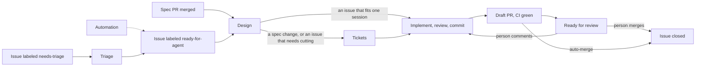

# Linewright product spec

Linewright is a spec-driven software factory: a server that watches a GitHub
repository and runs coding agents that turn spec changes and issues into
finished software, delivered as pull requests.

## Vision

A software factory: people write the specification and file the bugs, and the
factory produces the finished software. Agents plan, implement, review and
verify each other's work, with enough of them and enough automation that the
result needs little or no human review: most changes merge on their own, and
people review only the critical ones.

This spec describes the first version: from a merged spec change or an issue
to a pull request that agents have reviewed and that passes CI. It is merged,
by Linewright or by a person, or sent back with comments the factory
addresses.

## Problem Statement

I keep the specification of my software as Markdown in its repository, and
coding agents build from it. Reviewing what they build is the slow part: every
change comes back as a PR for me to read, understand and correct, and that is
where most of my time goes. The quality that would make review quick, work
that has been reviewed, tested and fixed before I see it, takes more agent
sessions than one person drives by hand. Driving them costs too: each step
between a spec change and a PR is a session I start, wait for and relay, so
work waits for me to be at a keyboard. Customer issues wait the same way:
someone has to read, classify, verify and brief before an agent can start.

## Solution

A server that polls GitHub, and optionally receives its webhooks, and drives a
pipeline of agent sessions from a merged spec change or an issue to a pull
request that is reviewed, green and ready for a person.

- **Spec in, PR out.** A merged spec change or a labeled issue starts the
  pipeline and a pull request ends it. Between the two the factory runs on
  its own; when it cannot continue, it hands the item back with a comment
  that says why.
- **The spec is how the maintainer steers.** Agents build from the spec,
  and a spec that needs changing becomes an issue for the maintainer.
- **Reviewed before a person sees it.** Agent review, the repository's own
  checks and CI all pass before a PR is marked ready.
- **The work shows in GitHub.** The state of the work lives in GitHub, kept
  as a person would keep it, so that people work in the repository together
  with the factory.
- **Labels say what an issue needs; assignees say who is working on it.**
  Linewright joins in as a teammate would: it claims an issue that needs
  what it can do, works an item only while it is assigned, and lets go when
  the item needs something it cannot do.
- **Each stage is a fresh agent session with a brief**, and work is cut so
  that every session stays in its smart zone, the part of its context window
  where it still works at full quality.
- **Unattended.** Agents run without permission prompts, directly on a host
  or in a container, as the operator chooses.
- **Automations beside the pipeline.** Automations in the repository run agents
  on a trigger with instructions the maintainer writes, and may hand work to
  the pipeline.
- **Runs again on request.** A spec change the factory handled can be
  captured as a case and run through the whole pipeline again, so the briefs
  are tuned against real cases.

A maintainer merges a pull request that adds invoices to the spec. Linewright
implements the change, has agents review the work and delivers it as pull
requests ready for review. The maintainer reviews them as they would a
person's, by commenting, and merges them, or lets Linewright merge them.

A reporter files an issue saying that exporting a report fails. An agent
triages it: it reproduces the failure and readies the issue for an agent to
fix, asks the reporter for what is missing, or hands it to the maintainer
with a recommendation. Linewright fixes a readied issue the way it builds a
spec change.

The pipeline, end to end:

## Areas

| Area | What it covers |
|---|---|
| [Repository](repository.md) | What Linewright needs from the repository, and how people and Linewright work together through it. |
| [Sources of work](sources_of_work.md) | What starts work. |
| [Webhooks](webhooks.md) | GitHub telling Linewright about changes as they happen. |
| [Triage](triage.md) | Deciding what happens to a new issue. |
| [Automations](automations.md) | Running agents on a trigger with the maintainer's instructions. |
| [Design](design.md) | Choosing the structure of the code before it is built, and cutting the work into tickets. |
| [Implementation](implementation.md) | Turning tickets into reviewed, committed branches. |
| [Pull requests](pull_requests.md) | Taking the work from a pull request to a merge. |
| [Runs](runs.md) | What holds for every piece of work Linewright does, whatever its stage. |
| [Operation](operation.md) | Running Linewright. |
| [Monitoring](monitoring.md) | Seeing what Linewright is doing and why, from a shell or a browser. |
| [Replay](replay.md) | Running a captured case through the pipeline again to tune the briefs. |

## Out of scope

Direction, not the first version:

- Forges other than GitHub.
- Accepting a file or setting under a name an earlier release used.
