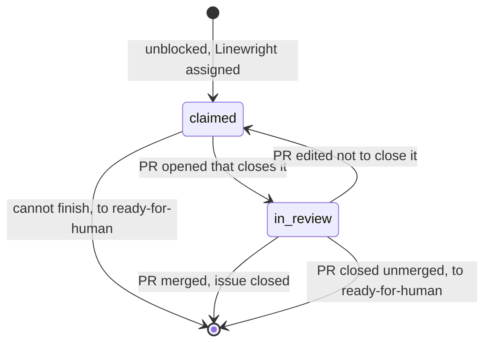

# Pull requests

The pull request is where the maintainer and the factory meet, and Linewright
works it like a careful contributor: it asks for review only once CI is green,
treats review as a conversation and answers in each thread, keeps the branch
mergeable, and takes a closed pull request as a no.

For example, the maintainer asks for a rename in a review comment. A rework
run makes the change, pushes, replies in the thread and asks the maintainer
to review again; the maintainer approves and merges.

## User Stories

1. As an operator, I want the PR to be a draft until CI passes, so that I am
   only asked to review green PRs.
2. As an operator, I want CI failures fixed by the agent, so that red CI costs
   me nothing.
3. As an operator, I want my review comments addressed and answered where I
   wrote them, so that review is a conversation with the branch.
4. As an operator, I want branches kept up to date with the default branch and
   mergeable by every method my repository allows, rewriting history only when
   they must, so that I pick how to merge and my review is not disturbed.
5. As an operator, I want to merge myself, so that nothing lands without me.
6. As an operator, I want closing a PR to mean rejection, so that the factory
   does not redo what I refused.
7. As an operator, I want to let Linewright merge its own green PRs, except
   those my repository requires a person to review, so that only the changes I
   have reserved for myself wait for me.

## Decisions

### The pull request

- When the implementer is done the manager pushes its branch and opens a
  **draft PR** from it to the default branch: title and body written by the
  agent for the diff, which Linewright ends with `Closes #N` for the ticket.
- Once Linewright opens a PR, the PR is the item its work is on: the runs
  that fix its CI, address its feedback and keep it up to date are the PR's,
  and the PR is steered on the PR. The ticket's label and assignee don't
  steer it.
- A PR is tied to issues only by GitHub's closing references, the closing
  keywords in its body and the issues linked to it by hand: it closes those
  issues, and each waits for it while it is open.
- A run on the PR that cannot finish hands the PR back (see [Runs](runs.md)),
  and removing `ready-for-human` from it tries again. A maintainer who labels
  the PR `ready-for-human` cancels its run and stops its work until they remove
  the label.
- Commits a person pushes to the branch are kept: every run starts from the
  branch as it is.
- A run that changes a PR so its description no longer fits rewrites the
  description, keeping the issues it closes.
- A PR closed without merging is the maintainer's no: each issue it closes
  that Linewright has claimed goes to `ready-for-human`. A reopened issue
  gets a fresh run once `ready-for-agent` is applied again.

### CI

- Linewright waits for check runs and commit statuses on the head to appear
  (grace period default 5 min; none means the repository has no CI for
  drafts) and to complete (default 6 h, then the PR is handed back naming the
  checks still running).
- A failure starts a fix session, at most 2 attempts, then the PR is handed
  back naming the failing check.
- The fix session is given, for each failing check, its name, what it reports
  about the failure, the end of the output of the step that failed (at most
  its last 50 lines, without timestamps) and where to read its full log.
  Where the log does not show which step failed, the end of the whole log
  stands in for the step's output. A check with no log, such as a commit
  status, gives its description and its link instead.
- Green: the PR is marked ready for review.

### Rework

- A comment or review from anyone other than Linewright, posted after
  Linewright's last push, starts a rework run; a review that only approves
  starts nothing.
- The run brings the branch up to date, addresses the comments, pushes,
  replies in each thread and re-requests review from the people whose
  comments it addressed.
- Comments from people are always addressed; those from other bots at the
  implementer's judgment, and it may answer that a comment needs no change.
  The implementer resolves the threads bots opened and leaves people's
  threads for them to resolve.
- Feedback posted while a run works goes to its session before the run
  pushes.

### Keeping up to date

- Every run first brings the branch up to date with the default branch.
- A PR GitHub reports behind the default branch, or not mergeable by a method
  the repository allows, gets a run for that alone, which needs an agent only
  for a conflict.
- By default an update merges the default branch into the branch, so
  reviewed history stays as it is, unless the branch would then not be
  mergeable by every method the repository allows; then the branch is
  rebased onto it. For example, a repository that requires linear history
  refuses a merge commit, and a conflict resolved in a merge commit leaves
  the branch impossible to rebase-merge.
- The `update-branch` setting overrides the default: `merge` never rewrites
  history, at the cost of the methods a merge commit rules out, and `rebase`
  always rebases.

### Merging

- Without `--auto-merge`, the maintainer merges the PR with whatever method
  the repository allows.
- With `--auto-merge`, Linewright merges each green PR it opened, with the
  `merge-method` setting: by default a rebase where the repository requires
  linear history, and otherwise the first method of merge, squash and rebase
  that the repository allows. This is Linewright merging, not GitHub's
  auto-merge feature.
- It merges only when GitHub allows it. A PR GitHub blocks is marked ready
  for review with a comment naming what GitHub requires, and is merged once
  GitHub allows it.
- A PR a person has commented on or reviewed is merged only once that
  person's newest comment or review is an approval. Bots' comments don't
  hold a merge.
- A merge that fails is retried once on the next poll, then the PR is handed
  back with GitHub's reason.
- Auto-merge covers every open PR Linewright opened, including those opened
  while it ran without `--auto-merge`.

The `work` states of the issue lifecycle, derived as under
[Repository](repository.md).

