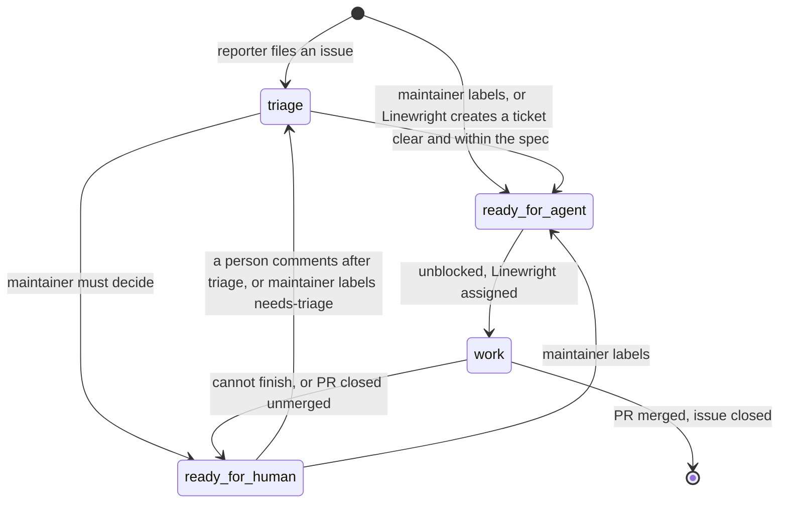

# Repository

Linewright joins a repository the way a new teammate would: as a GitHub user
of its own, beside the people already working there, through the issues,
labels, assignees and pull requests they already use. It shares the
repository rather than owning it. GitHub is both how people steer it and
where they see what it is doing, so working with Linewright needs nothing but
GitHub, and a comment on the issue or pull request records every outcome.

For example, the maintainer hands an issue to Linewright by labeling it, and
sees that Linewright has taken it on because the issue is assigned to
Linewright.
When Linewright cannot finish it, a comment on the issue says why.

## User Stories

1. As an operator, I want to point Linewright at a repository and have it create
   what it needs, so that setup is a token and a flag.
2. As an operator, I want the repository to stay usable by people at the same
   time, so that the factory shares the repository rather than owning it.
3. As an operator, I want Linewright to refuse to start when it cannot work, so
   that a misconfiguration is loud.
4. As an operator, I want to start work by applying one label and stop it by
   removing it, so that control needs nothing but GitHub.
5. As an operator, I want Linewright to start work only on the issues and pull
   requests I mark for it, so that I can adopt it a little at a time in a
   repository whose people already use its labels.
6. As an operator, I want every outcome recorded on the issue or PR it concerns,
   so that GitHub is the audit trail.

## Decisions

- Requirements:
  - A GitHub repository.
  - A GitHub user account for Linewright, with a token that lets it push
    branches, open pull requests, and read and write issues and labels.
    Everything Linewright does on GitHub carries that identity, so the
    maintainer can review its PRs and see its claims as assignments. With
    `--auto-merge`, the account must not be able to bypass the default
    branch's rules (no admin rights, not on a ruleset's bypass list), or the
    reviews they require are skipped.
  - Spec files: tracked Markdown matching the spec glob (default
    `docs/**/*.md`).
- Used when present: the files the agents' briefs rely on,
  `CODING_STANDARDS.md` (what code review holds changes to) and `GLOSSARY.md`
  (the vocabulary agents read before exploring), and CI as checks on pull
  requests. The agent instructions and configuration the runtime reads from
  the repository apply as in any session. The operator's own Claude Code
  setup does not, and sessions keep no memory of their own: what later
  sessions should know belongs in the repository.
- Labels. Linewright creates any that are missing at startup, except the
  required label, and never renames or deletes one. Labels only Linewright uses
  are prefixed `linewright:`.

  | label | meaning | set by |
  |---|---|---|
  | `needs-triage` | new, not yet assessed | reporter's issue template, maintainer |
  | `needs-info` | waiting on the reporter | Linewright |
  | `ready-for-agent` | actionable: Linewright may claim it | maintainer, Linewright |
  | `ready-for-human` | the maintainer must act or decide | Linewright |
  | `bug`, `enhancement` | category, in repositories without issue types | Linewright (triage), maintainer |
  | `linewright:spec-processed` | this merged PR's spec changes have been ticketed | Linewright |
  | the required label, named by `require-label` | Linewright may start work on this item | maintainer, Linewright |

- For issues, the human interface is two labels: `needs-triage` asks for
  triage and `ready-for-agent` asks for implementation. Spec changes need no
  label: every merged pull request that touches the spec is picked up.
  Removing `ready-for-agent`, unassigning Linewright or closing the
  issue stops its work; after an unassignment, applying `ready-for-agent`
  again restarts it.
- With `require-label` set, Linewright starts work only on issues and pull
  requests that carry the **required label**. It checks the label each time
  it starts something: triaging an issue, also again after a comment;
  claiming an issue, also again after an unassignment or a reopening; and
  cutting a spec change into tickets, also again after a handback. Work
  already started carries on without it, so removing the label stops
  nothing in flight and only keeps Linewright from starting more. Linewright
  puts the label on every issue and pull request it creates. Workflows run
  on their schedule either way. Unset, every issue and pull request is
  Linewright's to work.
- Machine state is derived from GitHub, never labeled, except which issue
  Linewright opened a pull request for, which Linewright records when it
  opens it. An issue is **claimed** when Linewright is among its assignees,
  and **in review** while the pull request Linewright opened for it is open.
  Other issues that pull request closes are not in review with it.
- Linewright comments at every outcome: a triage result, tickets created (on
  the tracking issue and the spec PR), a ticket handed back and why, a PR
  made ready, a rework done. Every comment opens with the marker line
  `> *Linewright, <stage>*` so people and the manager can tell its comments
  from others. Claims, PRs and merges need no comment: the assignee, the PR
  and the merge are the record.
- Comments contain only what belongs to the repository: no run ids, hosts or
  links to the factory.
- Startup checks: the token can push to the repository and, with
  `--auto-merge`, the repository allows the merge method and the update method
  keeps the branch mergeable with it (`update-branch` `merge` cannot keep a
  branch rebase-mergeable); with webhooks on, `serve` can listen on
  `webhook-address`; and `webhook-address` is not set without the webhook
  secret. Otherwise Linewright exits with an error.
- One Linewright per repository. A `serve` started for a repository whose
  `serve` already runs on the same host exits with an error saying so.

The lifecycle of an issue. `triage` and `work` each group several states,
drawn under [Triage](triage.md) and [Pull requests](pull_requests.md);
`ready-for-agent` and `ready-for-human` are the labels between them.

