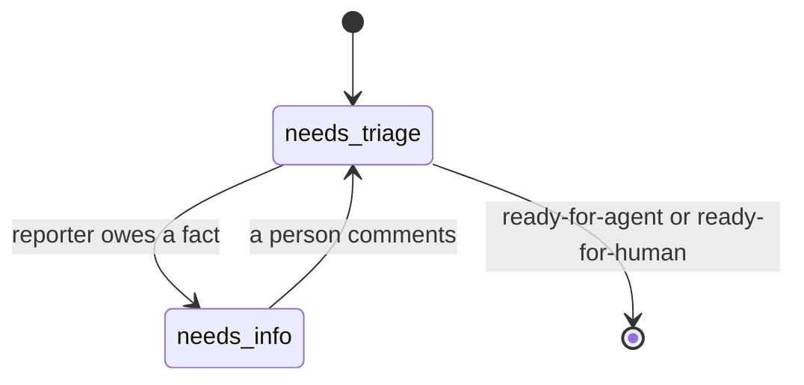

# Triage

Triage does the first reading of an issue that would otherwise fall to the
maintainer, and establishes the facts before anyone decides. It does the
research and leaves the decisions to people: it asks the reporter for what is
missing, makes clear issues into work, and hands every decision to the
maintainer with a recommendation.

For example, a bug report without steps to reproduce gets a comment asking
the reporter for them. When the reporter answers in the thread, the issue is
triaged again, the bug reproduced, and the issue becomes a ticket with a
brief an implementer works from.

## User Stories

1. As an operator, I want new issues classified and their claims verified, so
   that only real, clear work reaches an implementer.
2. As an operator, I want reporters asked for what is missing and their answers
   picked up, so that I am not the go-between.
3. As an operator, I want an issue that needs my decision handed to me with a
   recommendation and my answer in the thread picked up, so that my part is a
   decision, not research or bookkeeping.
4. As an operator, I want duplicates and already-fixed issues flagged rather
   than closed, so that no reporter is turned away by a machine.

## Decisions

- Triage runs on `needs-triage` issues not authored by Linewright
  (tickets Linewright creates are already briefed).
- The agent reads the issue and its comments, the codebase and the spec. It
  categorizes, verifies the claim (reproduces a bug, runs the tests, checks
  whether the behavior already exists) and ends in one of three states:
  - `ready-for-agent`, with a **triage brief** comment: summary, current and
    desired behavior, acceptance criteria, out of scope.
  - `needs-info`, with a comment addressed to the reporter: what is
    established, what is still needed.
  - `ready-for-human`, with a recommendation: the questions a maintainer must
    answer, or why the issue is not for an agent (duplicate, already
    implemented, needs a spec change, should be rejected).

  Facts come before decisions: while the reporter still owes a fact, the
  outcome is `needs-info`, asking only for it, even if a maintainer's
  decision will follow, because the decision usually depends on the facts.
- The category is the repository's issue type (Bug, Feature, Task) where the
  repository has issue types, and the `bug` or `enhancement` label otherwise.
- Triage leaves issues open and repository files as they are.
- An answer in the thread is picked up: when anyone other than Linewright
  comments on a `needs-info` or `ready-for-human` issue after
  Linewright's last triage comment, and that is its last comment on the
  issue, the issue is triaged again. The labels say who must answer, the
  reporter or the maintainer; either may answer by commenting, because that
  is where the question was asked. The maintainer may also hand an issue back
  with a label: `ready-for-agent` (implement as decided) or `needs-triage`
  (triage again).

The `triage` states of the issue lifecycle; both are labels.

