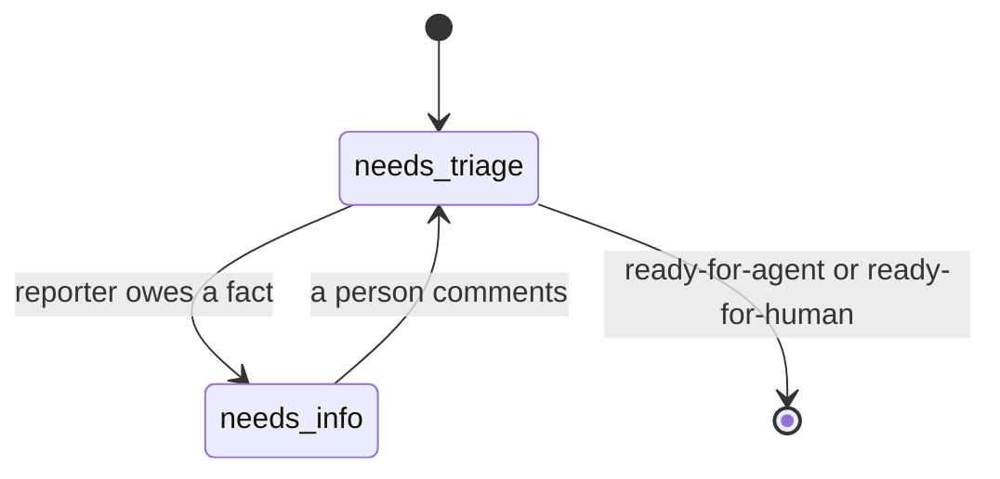

# Triage

Triage is the first reading of a new issue: it establishes the facts, so that
the people who decide don't have to do the research. The decisions stay
theirs.

For example, a bug report without steps to reproduce gets a comment asking
the reporter for them. When the reporter answers in the thread, the issue is
triaged again, the bug reproduced, and the issue becomes a ticket with a
brief an implementer works from.

## User Stories

1. As an operator, I want new issues classified and their claims verified, so
   that only real, clear work reaches an implementer.
2. As an operator, I want reporters asked for what is missing and their answers
   picked up, so that I am not the go-between.
3. As an operator, I want an issue that needs my decision handed to me with a
   recommendation, so that my part is a decision, not research or
   bookkeeping.
4. As an operator, I want duplicates and already-fixed issues flagged rather
   than closed, so that no reporter is turned away by a machine.

## Decisions

- Triage runs on `needs-triage` issues not authored by Linewright
  (tickets Linewright creates are already briefed).
- The agent reads the issue and its comments, the codebase and the spec. It
  categorizes, verifies the claim (reproduces a bug, runs the tests, checks
  whether the behavior already exists) and ends in one of three states:
  - `ready-for-agent`, with a **triage brief** comment: summary, current and
    desired behavior, acceptance criteria, out of scope.
  - `needs-info`, with a comment addressed to the reporter: what is
    established, what is still needed.
  - `ready-for-human`, with a recommendation: the questions a maintainer must
    answer, or why the issue is not for an agent (duplicate, already
    implemented, needs a spec change, should be rejected).

  Facts come before decisions: while the reporter still owes a fact, the
  outcome is `needs-info`, asking only for it, even if a maintainer's
  decision will follow, because the decision usually depends on the facts.
- The category is the repository's issue type (Bug, Feature, Task) where the
  repository has issue types, and the `bug` or `enhancement` label otherwise.
- Triage leaves issues open and repository files as they are.

### Answers

The label says who must answer, and how.

- `needs-info`: the reporter answers in the thread. A reply, a comment from
  anyone other than Linewright posted after its question, triages the issue
  again.
- `ready-for-human`, whoever handed the issue back: the maintainer answers
  with a label, `ready-for-agent` to implement as decided or `needs-triage`
  to triage again.

The `triage` states of the issue lifecycle; both are labels.

